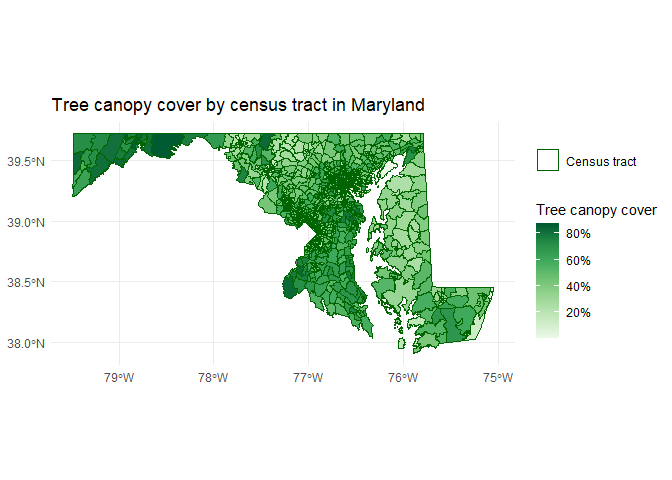
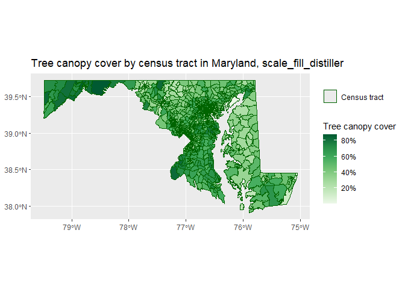
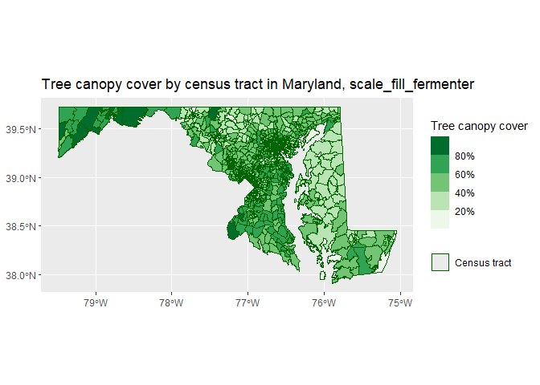
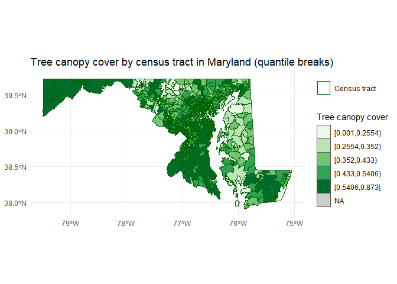
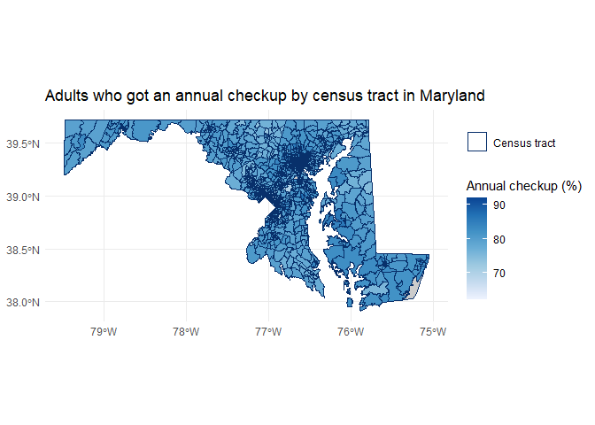
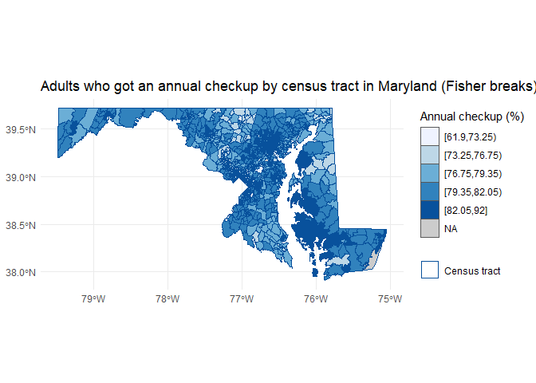

# Mapping data to space


``` r
library(ggplot2) 
```

    Warning: package 'ggplot2' was built under R version 4.5.3

``` r
library(dplyr)
```

    Warning: package 'dplyr' was built under R version 4.5.3

    Attaching package: 'dplyr'

    The following objects are masked from 'package:stats':

        filter, lag

    The following objects are masked from 'package:base':

        intersect, setdiff, setequal, union

``` r
library(sf)
```

    Warning: package 'sf' was built under R version 4.5.3

    Linking to GEOS 3.14.1, GDAL 3.12.1, PROJ 9.7.1; sf_use_s2() is TRUE

## Choropleths

Let’s make a choropleth! Pick any of the tract-level data we have
available in justviz (ACS \[`acs`\], CDC \[`cdc`\], EJSCREEN
\[`ej_natl`\], vacants \[`vacants_by_tract`\], or climate vulnerability
\[`climate`\]), reshape or filter it if necessary to have your variable
of interest as its own column (i.e. CDC needs to be reshaped to wide
format or filtered for just one indicator). Join it with a tract
shapefile (`justviz::tracts_sf`, get a full set of the state’s tracts
with `tigris::tracts`, and/or filter for whatever counties you want),
making sure to put the `sf` data frame on the left side of your join so
you retain its data type. Then use `geom_sf` to make a choropleth of a
continuous variable. Use `scale_fill_distiller` to use a ColorBrewer
palette on continuous data.

``` r
# load climate data and picked tree canopy cover as variable of interest
clim <- justviz::climate |>
  select(geoid, tcc)

# i wanna look at all of maryland --> load from tigris
md_tracts <- tigris::tracts(state = "MD", cb = TRUE, year = 2020)

clim_sf <- md_tracts |>
  left_join(clim, by = c("GEOID" = "geoid"))

ggplot(clim_sf) +
  geom_sf(aes(fill = tcc, color = "Census tract"), linewidth = 0.01) +
  scale_fill_distiller(palette = "Greens",
                       direction = 1,
                       labels = scales::label_percent()) + 
  # legend hacking to show census tract border
  # (using black or white is ugly across whole state, but darkgreen pretty but
  # could be misinterpreted as lines of 100% canopy cover)
  scale_color_manual(values = "darkgreen", name = NULL) +
  guides(color = guide_legend(override.aes = list(fill = NA, linewidth = 0.5))) +  
  labs(title = "Tree canopy cover by census tract in Maryland",
       fill = "Tree canopy cover") +
  theme_minimal()
```



Study the docs for `scale_fill_distiller` to understand the difference
between the brewer, distiller, and fermenter variants (beyond the punny
names). Try all three with your data—only 2 of them will work. Decide
which you like best for this data. What tradeoffs do you find between
legibility and precision?

``` r
testing_palettes <-
  ggplot(clim_sf) +
  geom_sf(aes(fill = tcc, color = "Census tract"), linewidth = 0.01) +
  scale_color_manual(values = "darkgreen", name = NULL) +
  guides(color = guide_legend(override.aes = list(fill = NA, linewidth = 0.5))) 

# distiller
testing_palettes +
   scale_fill_distiller(palette = "Greens",
                        direction = 1,
                        labels = scales::label_percent()) +
  labs(title = "Tree canopy cover by census tract in Maryland, scale_fill_distiller",
       fill = "Tree canopy cover") 
```



``` r
#fermenter
testing_palettes + 
  scale_fill_fermenter(palette = "Greens",
                       direction = 1,
                      labels = scales::label_percent()) +
  labs(title = "Tree canopy cover by census tract in Maryland, scale_fill_fermenter",
       fill = "Tree canopy cover") 
```



``` r
# brewer
testing_palettes +
  scale_fill_brewer(palette = "Greens",
                    direction = 1,
                    labels = scales::label_percent()) + # this one doesnt work
  labs(title = "Tree canopy cover by census tract in Maryland, scale_fill_brewer",
       fill = "Tree canopy cover") 
```

    Error in `scale_fill_brewer()`:
    ! Continuous value supplied to a discrete scale.
    ℹ Example values: 0.398, 0.456, 0.343, 0.524, and 0.304.

Originally, I used distiller because that’s what the course notes has as
an example. I still like distiller better than the other two. It doesn’t
bin together data like fermenter does, and brewer doesn’t work b/c it’s
meant for discrete data, not continuous. I like how the map shows the
full range of the data, even if some values may not be as easy to tell
apart. Fermenter loses precision in favor of legibility.

## Binning algorithms

It’s common to use binning algorithms to cut continuous values into bins
for a choropleth, but the choice of algorithm can dramatically change
how the data is understood. The function `justviz::jenks` will cut a
continuous variable into binned values and return a factor, using the
Jenks/Fisher algorithms. These are designed to highlight skewed data
well, but aren’t the best choice for all situations.

Instead, experiment with the function `classInt::classify_intervals`,
which gives you access to several different algorithms. Depending on the
algorithm and distribution of your data, the number of classes you
request might be a goal but not necessarily what you get. Use it like
this:

``` r
justviz::ej_natl |>
    dplyr::filter(indicator == "pm25") |>
    dplyr::mutate(value_brk = classInt::classify_intervals(value_ptile, n = 5, style = "pretty"))
```

Now before remaking your choropleth, cut the variable into bins using
one of the algorithms available in `classify_intervals` (look at the
function docs). The binned column will be a factor. Use this column for
the choropleth’s fill, and use the same palette as above with
`scale_fill_brewer`. Try multiple algorithms—some will give you way more
bins than you can get a palette for, some will give too few to be
useful, so just mess around with arguments.

``` r
# how many bins/whats the dist for each?
  tcc_equal    = classInt::classify_intervals(clim_sf$tcc, n = 5, style = "equal")
```

    Warning in classIntervals(var = var, n = n, style = style, rtimes = rtimes, :
    var has missing values, omitted in finding classes

``` r
  tcc_quantile = classInt::classify_intervals(clim_sf$tcc, n = 5, style = "quantile")
```

    Warning in classIntervals(var = var, n = n, style = style, rtimes = rtimes, :
    var has missing values, omitted in finding classes

``` r
  tcc_fisher   = classInt::classify_intervals(clim_sf$tcc, n = 5, style = "fisher")
```

    Warning in classIntervals(var = var, n = n, style = style, rtimes = rtimes, :
    var has missing values, omitted in finding classes

``` r
  tcc_pretty   = classInt::classify_intervals(clim_sf$tcc, n = 5, style = "pretty")
```

    Warning in classIntervals(var = var, n = n, style = style, rtimes = rtimes, :
    var has missing values, omitted in finding classes

``` r
  tcc_sd       = classInt::classify_intervals(clim_sf$tcc, style = "sd")
```

    Warning in classIntervals(var = var, n = n, style = style, rtimes = rtimes, :
    var has missing values, omitted in finding classes

``` r
# print
  table(tcc_equal)
```

    tcc_equal
     [0.001,0.1754) [0.1754,0.3498) [0.3498,0.5242) [0.5242,0.6986)  [0.6986,0.873] 
                141             437             555             272              58 

``` r
  table(tcc_quantile)
```

    tcc_quantile
    [0.001,0.2554) [0.2554,0.352)  [0.352,0.433) [0.433,0.5406) [0.5406,0.873] 
               293            291            292            294            293 

``` r
  table(tcc_fisher)
```

    tcc_fisher
      [0.001,0.217)  [0.217,0.3505) [0.3505,0.4765)  [0.4765,0.619)   [0.619,0.873] 
                211             371             432             294             155 

``` r
  table(tcc_pretty)
```

    tcc_pretty
      [0,0.2) [0.2,0.4) [0.4,0.6) [0.6,0.8)   [0.8,1] 
          175       593       517       164        14 

``` r
  table(tcc_sd)
```

    tcc_sd
    [-0.01786293,0.06535764)   [0.06535764,0.1485782)    [0.1485782,0.2317988) 
                          15                       91                      137 
       [0.2317988,0.3150193)    [0.3150193,0.3982399)    [0.3982399,0.4814605) 
                         220                      299                      269 
       [0.4814605,0.5646811)    [0.5646811,0.6479016)    [0.6479016,0.7311222) 
                         179                      136                       77 
       [0.7311222,0.8143428)    [0.8143428,0.8975633] 
                          30                       10 

``` r
# add each binning to clim_sf
  clim_sf <- clim_sf |>
    mutate(
      tcc_equal    = classInt::classify_intervals(tcc, n = 5, style = "equal"),
      tcc_quantile = classInt::classify_intervals(tcc, n = 5, style = "quantile"),
      tcc_fisher   = classInt::classify_intervals(tcc, n = 5, style = "fisher"),
      tcc_pretty = classInt::classify_intervals(tcc, n = 5, style = "pretty"),
      tcc_sd = classInt::classify_intervals(tcc, style = "sd")
  )
```

    Warning: There were 5 warnings in `stopifnot()`.
    The first warning was:
    ℹ In argument: `tcc_equal = classInt::classify_intervals(tcc, n = 5, style =
      "equal")`.
    Caused by warning in `classIntervals()`:
    ! var has missing values, omitted in finding classes
    ℹ Run `dplyr::last_dplyr_warnings()` to see the 4 remaining warnings.

``` r
# so I can copy paste with diff binning algorithms  
binning_base <- ggplot(clim_sf) +
  scale_color_manual(values = "darkgreen", name = NULL) +
  guides(color = guide_legend(override.aes = list(fill = NA, linewidth = 0.5))) +
  theme_minimal()


# two different binning algorithms:
# fisher
binning_base +
  geom_sf(aes(fill = tcc_fisher, color = "Census tract"), linewidth = 0.01) +
  scale_fill_brewer(palette = "Greens", direction = 1, na.value = "grey80") +
  labs(title = "Tree canopy cover by census tract in Maryland (Fisher breaks)",
       fill = "Tree canopy cover")
```


``` r
# quantile
binning_base +
  geom_sf(aes(fill = tcc_quantile, color = "Census tract"), linewidth = 0.01) +
  scale_fill_brewer(palette = "Greens", direction = 1, na.value = "grey80") +
  labs(title = "Tree canopy cover by census tract in Maryland (quantile breaks)",
       fill = "Tree canopy cover")
```



## Do it all again

Now that you’ve made a choropleth with a sequential fill, and found a
binning algorithm that works well for the same data, try it all again
with a different variable. Pick something with a different
distribution—if the first variable was very skewed, try something closer
to a normal or uniform distribution.

``` r
cdc <- justviz::cdc |>
  filter(indicator == "Annual checkup") |>  
  select(location, value)

cdc_sf <- md_tracts |>
  left_join(cdc, by = c("GEOID" = "location"))

# how many bins/whats the dist for each?
  cdc_equal    = classInt::classify_intervals(cdc_sf$value, n = 5, style = "equal")
```

    Warning in classIntervals(var = var, n = n, style = style, rtimes = rtimes, :
    var has missing values, omitted in finding classes

``` r
  cdc_quantile = classInt::classify_intervals(cdc_sf$value, n = 5, style = "quantile")
```

    Warning in classIntervals(var = var, n = n, style = style, rtimes = rtimes, :
    var has missing values, omitted in finding classes

``` r
  cdc_fisher   = classInt::classify_intervals(cdc_sf$value, n = 5, style = "fisher")
```

    Warning in classIntervals(var = var, n = n, style = style, rtimes = rtimes, :
    var has missing values, omitted in finding classes

``` r
  cdc_pretty   = classInt::classify_intervals(cdc_sf$value, n = 5, style = "pretty")
```

    Warning in classIntervals(var = var, n = n, style = style, rtimes = rtimes, :
    var has missing values, omitted in finding classes

``` r
  cdc_sd       = classInt::classify_intervals(cdc_sf$value, style = "sd")
```

    Warning in classIntervals(var = var, n = n, style = style, rtimes = rtimes, :
    var has missing values, omitted in finding classes

``` r
cdc_sf <- cdc_sf |>
mutate(value_brk = classInt::classify_intervals(value, n = 5, style = "fisher"))
```

    Warning: There was 1 warning in `stopifnot()`.
    ℹ In argument: `value_brk = classInt::classify_intervals(value, n = 5, style =
      "fisher")`.
    Caused by warning in `classIntervals()`:
    ! var has missing values, omitted in finding classes

``` r
# continuous
ggplot(cdc_sf) +
  geom_sf(aes(fill = value, color = "Census tract"), linewidth = 0.01) +
  scale_fill_distiller(palette = "Blues", direction = 1, na.value = "grey80") +
  scale_color_manual(values = "#08306B", name = NULL) +
  guides(color = guide_legend(override.aes = list(fill = NA, linewidth = 0.5))) +
  labs(title = "Adults who got an annual checkup by census tract in Maryland",
       fill = "Annual checkup (%)") +
  theme_minimal()
```



``` r
# binned
ggplot(cdc_sf) +
  geom_sf(aes(fill = value_brk, color = "Census tract"), linewidth = 0.01) +
  scale_fill_brewer(palette = "Blues", direction = 1, na.value = "grey80") +
  scale_color_manual(values = "#08519C", name = NULL) +
  guides(color = guide_legend(override.aes = list(fill = NA, linewidth = 0.5))) +
  labs(title = "Adults who got an annual checkup by census tract in Maryland (Fisher breaks)",
       fill = "Annual checkup (%)") +
  theme_minimal()
```


