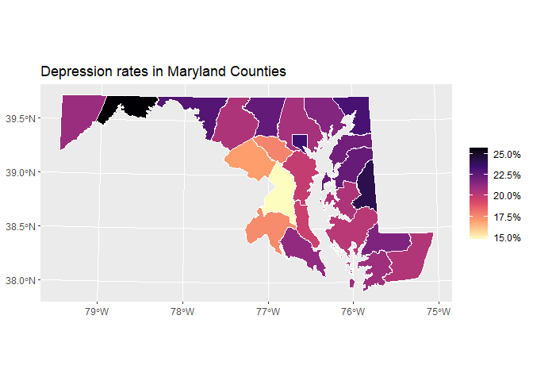
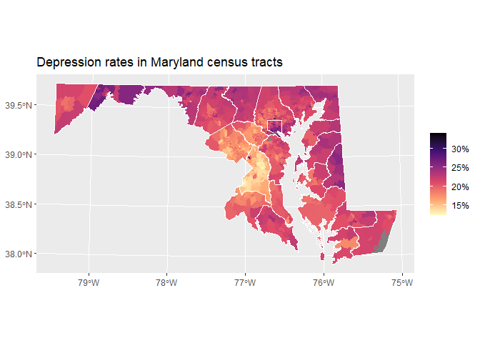
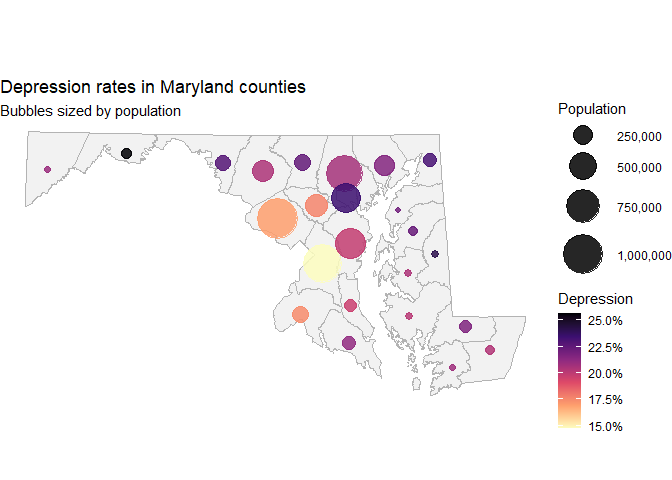
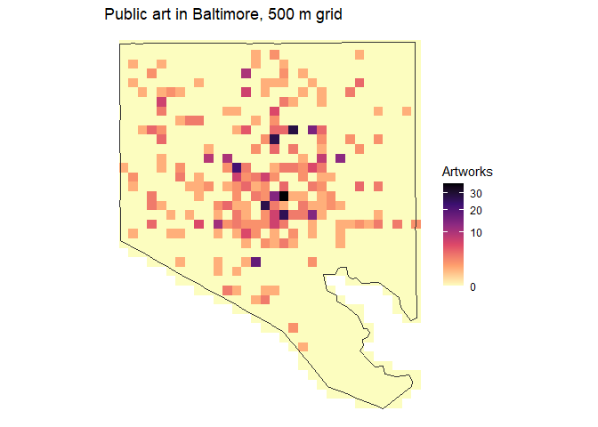
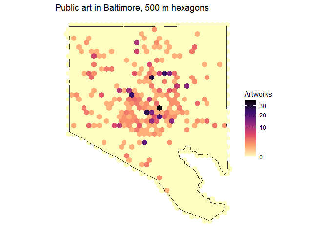
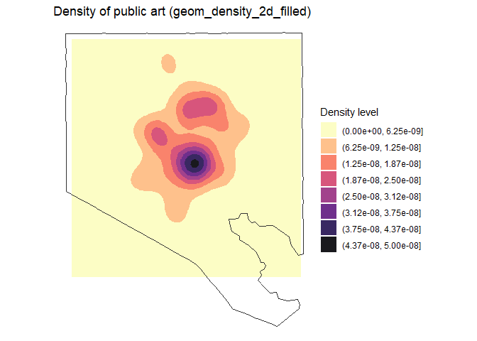

# Changing & manipulating geographies


## Alternatives to the choropleth

``` r
library(ggplot2)
```

    Warning: package 'ggplot2' was built under R version 4.5.3

``` r
library(sf) 
```

    Warning: package 'sf' was built under R version 4.5.3

    Linking to GEOS 3.14.1, GDAL 3.12.1, PROJ 9.7.1; sf_use_s2() is TRUE

``` r
library(terra)
```

    Warning: package 'terra' was built under R version 4.5.3

    terra 1.9.50

``` r
library(dplyr)
```

    Warning: package 'dplyr' was built under R version 4.5.3

    Attaching package: 'dplyr'

    The following objects are masked from 'package:terra':

        intersect, union

    The following objects are masked from 'package:stats':

        filter, lag

    The following objects are masked from 'package:base':

        intersect, setdiff, setequal, union

``` r
tracts_sf <- tigris::tracts(state = "MD", cb = TRUE) |>
    dplyr::select(tract = GEOID, county = NAMELSADCO)
```

    Retrieving data for the year 2025

``` r
counties_sf <- tigris::counties(state = 'MD', cb = TRUE) |>
    dplyr::select(county = NAMELSAD)
```

    Retrieving data for the year 2025

We’re going to do some experiments. Start with basic choropleths. Use
either the ACS data or CDC data so you can try the same techniques for
both counties and tracts.

``` r
county_cdc <- justviz::cdc |>
    filter(level == "county", indicator == "Depression") |>
    select(county = location, value, pop)

tract_cdc <- justviz::cdc |>
    filter(level == "tract", indicator == "Depression") |>
    select(tract = location, value, pop)

counties_cdc_sf <- counties_sf |>
    left_join(county_cdc, by = "county") |>
    st_transform(26985)

tracts_cdc_sf <- tracts_sf |>
    left_join(tract_cdc, by = "tract") |>
    st_transform(26985)

ggplot(counties_cdc_sf) +
    geom_sf(aes(fill = value), 
            color = "white", 
            linewidth = 0.2) +
    scale_fill_viridis_c(labels = scales::label_percent(scale = 1), 
                         option = "magma", 
                         direction = -1) +
    labs(title = paste("Depression rates in Maryland Counties"), fill = NULL) 
```



``` r
ggplot(tracts_cdc_sf) +
    geom_sf(aes(fill = value), 
            color = NA) +
    geom_sf(data = counties_cdc_sf, 
            fill = NA, 
            color = "white", 
            linewidth = 0.3) +
    scale_fill_viridis_c(labels = scales::label_percent(scale = 1), 
                         option = "magma", 
                         direction = -1) +
    labs(title = paste("Depression rates in Maryland census tracts"), fill = NULL) 
```



Now try some of the adjustments from the notes: get centroids and make
bubble maps; try cartograms; scale opacity by some useful population
measure. Do the techniques that work for the state’s 24 counties work as
well for all 1,464 tracts? What about for tracts within just one or two
counties—at what point do things get too cluttered?

``` r
county_pts <- st_point_on_surface(counties_cdc_sf)
```

    Warning: st_point_on_surface assumes attributes are constant over geometries

``` r
tract_pts <- st_point_on_surface(tracts_cdc_sf)
```

    Warning: st_point_on_surface assumes attributes are constant over geometries

``` r
# counties
ggplot() +
    geom_sf(data = counties_cdc_sf, 
            fill = "grey95", 
            color = "grey70", 
            linewidth = 0.2) +
    geom_sf(data = county_pts, 
            aes(size = pop, 
                color = value), 
            alpha = 0.85) +
    scale_size_area(max_size = 14,
                    labels = scales::label_comma()) +
    scale_color_viridis_c(labels = scales::label_percent(scale = 1), 
                          option = "magma", 
                          direction = -1) +
    labs(title = "Depression rates in Maryland counties",
         subtitle = "Bubbles sized by population",
         size = "Population", 
         color = "Depression") +
  theme_void()
```



``` r
# tracts
tract_depression <- 
  ggplot() +
    geom_sf(data = tracts_cdc_sf, 
            fill = "gray95", 
            color = "gray70", 
            linewidth = 0.2) +
    geom_sf(data = tract_pts, 
            aes(size = pop, 
                color = value), 
            alpha = 0.85) +
    scale_size_area(max_size = 5,
                    labels = scales::label_comma()) +
    scale_color_viridis_c(labels = scales::label_percent(scale = 1), 
                          option = "magma", 
                          direction = -1,
                          na.value = "grey50") +
    labs(title = "Depression rates in Maryland census tracts",
         subtitle = "Bubbles sized by population",
         size = "Population", 
         color = "Depression") +
  theme_void()

ggsave(here::here("plots", "tract_depression_bubble.png"),
       tract_depression, dpi = 300)
```

    Saving 7 x 5 in image

    Warning: Removed 6 rows containing missing values or values outside the scale range
    (`geom_sf()`).

``` r
county_carto <- cartogram::cartogram_cont(counties_cdc_sf, weight = "pop", itermax = 10)

depression_carto <-
  ggplot(county_carto) +
    geom_sf(aes(fill = value), 
            color = "white", 
            linewidth = 0.2) +
    scale_fill_viridis_c(labels = scales::label_percent(scale = 1), 
                         option = "magma", 
                         direction = -1) +
    labs(
      title = "Depression rates in Maryland Counties", 
      subtitle = "Counties sized by population",
      fill = "Depression:"
      ) +
  theme_void()

ggsave(here::here("plots", "depression_carto.png"),
       depression_carto, dpi = 300)
```

    Saving 7 x 5 in image

## Simplifying points

Obtain some point data in one of 3 ways:

- Use one of the point datasets from `justviz` (either `vacants_sf` or
  `art_sf`)
- Download point data from OSM (look through the
  [wiki](https://wiki.openstreetmap.org/wiki/Map_features) for the
  feature type you want). Make sure it’s something that will return
  points, such as bus stops or benches. The wiki table has an icon for
  features that return nodes.
- Download point data from a local open data portal:
  - Baltimore city https://data.baltimorecity.gov
  - Maryland GIS https://data.imap.maryland.gov/

### Gridding

Create a grid over the relevant area (the state, a county, etc) using
`sf::st_make_grid`. Experiment with making a grid by the number of cells
vs cells of a certain size. Then join your points to the grid and
aggregate your points to the grid This might mean just taking the count
of points in each grid cell, or something like averaging an attribute,
depending on your data and what you want to do with it.

Map your gridded data. Pay attention to color palettes that work well.
If there are any other shapes you want to overlay, such as boundaries or
related features, add those as new layers. Try this a few times,
experimenting with different ways to structure the grid to see what
gives you the best balance between granularity and legibility. (You
could also try a hexagonal grid, or plot cells as points instead of
polygons.)

``` r
balt_sf <- counties_sf |>
    filter(county == "Baltimore city") |>
    st_transform(26985)

art <- justviz::art_sf |>
    st_transform(26985) |>
    st_filter(balt_sf)

# 500m grid
grid_size <- 
  st_make_grid(balt_sf, 
               cellsize = 500) |>
    st_as_sf() |>
    st_filter(balt_sf)
grid_size$n <- lengths(st_intersects(grid_size, art))

ggplot() +
    geom_sf(data = grid_size, 
            aes(fill = n), 
            color = NA) +
    geom_sf(data = balt_sf, 
            fill = NA, 
            color = "gray20", 
            linewidth = 0.4) +
    scale_fill_viridis_c(option = "magma", 
                         direction = -1, 
                         trans = "sqrt") +
    labs(
      title = "Public art in Baltimore, 500 m grid", 
      fill = "Artworks"
         ) +
    theme_void()
```



``` r
# hexagon grid
grid_hex <- 
  st_make_grid(balt_sf, 
               cellsize = 500, 
               square = FALSE) |>
    st_as_sf() |>
    st_filter(balt_sf)
grid_hex$n <- lengths(st_intersects(grid_hex, art))

art_hex <- ggplot() +
    geom_sf(data = grid_hex, aes(fill = n), color = NA) +
    geom_sf(data = balt_sf, fill = NA, color = "gray20", linewidth = 0.4) +
    scale_fill_viridis_c(option = "magma", direction = -1, trans = "sqrt") +
    labs(
      title = "Public art in Baltimore, 500 m hexagons", 
      fill = "Artworks"
         ) +
    theme_void()
art_hex
```



### Densities

Now take the same points and map their density. You can try the easy
method (`geom_density_2d_filled` or its variants). Or, go ahead and use
the proper method outlined in the notes with `spatstat`, first
calculating a KDE, then converting it to a raster.

``` r
art_xy <- as.data.frame(st_coordinates(art))

ggplot() +
    geom_density_2d_filled(data = art_xy, 
                           aes(X, Y), 
                           bins = 8, 
                           alpha = 0.9) +
    geom_sf(data = balt_sf, 
            fill = NA, 
            color = "gray20", 
            linewidth = 0.4) +
    scale_fill_viridis_d(option = "magma", 
                         direction = -1) +
    labs(
      title = "Density of public art (geom_density_2d_filled)",
      fill = "Density level") +
    theme_void()
```


